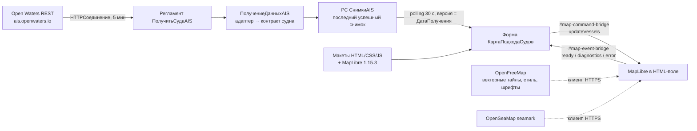

# Этап 1. Карта подхода судов к порту Владивосток (MapLibre в 1С)

## 1. Цель

**Проект Harbor** — отслеживание подхода судов к порту Владивосток. Отображение только в 1С.

**Цель этапа 1** — работающая в тонком клиенте 1С интерактивная карта акватории с судами из AIS:

- векторная подложка OSM, навигационная обстановка (якорные стоянки, лоцманские точки, фарватеры);
- суда — стрелками по курсу на мелком масштабе и корпусами в реальном размере на крупном;
- данные обновляются без перезагрузки карты.

Источник данных на этапе 1 временный и заведомо **неактуальный** (см. 3.1). Задача этапа — визуализация и инфраструктура (получение → снимок → форма → карта). Источник данных позже заменяется без переделки карты: адаптер в 1С приводит данные к внутреннему контракту (раздел 5).

## 2. Исходные условия

### 2.1. Проект и платформа

- Репозиторий: `C:\1c\GIT\harbor`, проект 1С:EDT `Harbor`. Сейчас пустая конфигурация: только `src/Configuration`.
- Платформа и режим совместимости **8.3.27**, язык встроенного языка — русский, управляемое приложение, `modalityUseMode = DontUse`, `synchronousPlatformExtensionAndAddInCallUseMode = DontUse`. На машине разработчика установлены 8.3.27.1719 / 2130 / 2325, а также 8.5.1 (для проекта не используется).
- Метаданные менять через **EDT MCP** (`http://localhost:8765/mcp`, EDT 2026.1.2.2), а не правкой XML. Стандарты 1С — через **v8std MCP**.
- Правила репозитория — `AGENTS.md` в корне. Работа с формами через EDT MCP — `docs/edt-forms.md`. Ревью планов кладётся рядом с планом (`.cursor/rules/ревью-планов.mdc`).

### 2.2. Связь с цифровым двойником D3

В будущем Harbor может быть интегрирован с картой контейнерного терминала — проектом **D3** (`C:\1c\d3`, конфигурация `d3`, обработка `ЦифровойДвойникПорта`). На этапе 1 Harbor — **отдельная** конфигурация, код D3 не трогаем. Из D3 переиспользуем **подходы** (проверено ревью по коду D3):

- HTML-страница собирается на сервере из макетов `МакетHTML` + `МакетCSS` + `МакетJS` заменой плейсхолдеров (`СтрЗаменить`) и передаётся строкой в поле HTML-документа. JSON, вставляемый в `<script>`, экранируется `"</"` → `"<\/"`. Реализация в D3: `ObjectModule.bsl`, функция `СобратьHTMLСцены`.
- Обмен 1С ↔ JS — через скрытые элементы-«мосты» в HTML. В D3 это `#scene-command-bridge` и `#pick-bridge`.
  - 1С → JS (клиентская `ОтправитьПолезнуюНагрузкуСцене` в `Forms/Форма/Module.bsl`): `Документ.getElementById`, проверка `data-ready`, `setAttribute("data-payload")`, `setAttribute("data-seq")`, затем `click()`, при исключении — `fireEvent("onclick")`, далее чтение `data-ack` / `data-error`. Текст команды собирается конкатенацией готовой строки JSON из снимка, без повторного разбора на клиенте (`ТекстКомандыСцены`).
  - JS → 1С: JS кликает по ссылке (`click()`, запасной путь — `dispatchEvent`) с `href="#pick:..."`. В `HTMLПриНажатии` 1С берёт тип из `Href`, а данные — из атрибутов узла `ДанныеСобытия.Anchor` (запасной путь — `ДанныеСобытия.Element`).
- Внешние источники опрашиваются **регламентными заданиями**, которые пишут последний успешный снимок в независимый регистр сведений: ресурс `ДанныеJSON` — строка неограниченной длины, запись набором с отбором по измерению-источнику (D3: `ЗаписатьГотовуюСтрокуСнимка`). Форма не ходит во внешние системы, а опрашивает регистр. Ошибка получения пишется в журнал (D3: `ЗаписатьОшибку`, подробное представление ошибки) и не стирает прежний снимок. Успешный пустой ответ — актуальное пустое состояние.
- Роли `Администратор` (все права, не основная) и `Пользователь` (у регистра снимков только чтение). Набор ролей БСП по #std488 не переносится: конфигурация без БСП, D3 так не сделан.
- Принципы SOLID / DRY / KISS — `AGENTS.md`.

Отличия от D3:

- Viewer D3 — чистый Canvas 2D без внешних библиотек. В Harbor сознательно используется **MapLibre GL JS** (WebGL2), встроенный в макет, а не подключённый с CDN.
- D3 хранит дату снимка как `ТекущаяДатаСеанса()`. Harbor хранит `ТекущаяУниверсальнаяДата()`, потому что `seen` приходит в UTC и возраст позиции считается в UTC.

Географические опорные данные:

- Терминал ВМКТ: юго-западный угол ограждения `EPSG:32652 E=734400 N=4774800`, это ≈ **43.0897° с. ш., 131.8799° в. д.** (`C:\1c\d3\data\scene_origin.txt`). Он находится у выхода бухты Золотой Рог в пролив Босфор Восточный.
- Геометрия D3 (`C:\1c\d3\data\geojson\*.geojson`) хранится в UTM 52N (`EPSG:32652`). MapLibre работает только в WGS84 / Web Mercator. Поэтому при будущей интеграции эти слои нужно один раз пересчитать в WGS84 при сборке. На этапе 1 не делаем.

### 2.3. Принятые решения и их обоснование

| Вопрос | Решение на этап 1 | Почему |
|---|---|---|
| Данные AIS | REST **Open Waters** `https://ais.openwaters.io/v1/vessels`; фактический источник в районе Владивостока — **AISHub** | Бесплатно, без ключа, GeoJSON. Вопрос постоянного источника отложен (см. 3.3) |
| Подложка | Векторные тайлы **OpenFreeMap** (схема OpenMapTiles, данные OSM), стиль Positron или Liberty | Бесплатно, без ключей и лимитов, CORS `*`, есть `name:ru` |
| Морская обстановка | Растровый слой **OpenSeaMap** `seamark` поверх подложки | В районе Владивостока есть якорные стоянки, лоцманские точки, границы районов (проверено на z12) |
| Библиотека карты | ~~MapLibre GL JS 5.24.0~~ → **MapLibre GL JS 1.15.3** (решение после шага 0, см. ниже), UMD-сборка, встроена в макет | Плавный масштаб и вращение, стилизация выражениями, тысячи объектов. Версия 6.x не подходит (см. ниже) |
| Запасной вариант | Leaflet 1.9.4 (Canvas/DOM, без WebGL) | Если диагностика покажет, что библиотека не загружается, WebGL2 или worker в HTML-поле не работают |

**Почему не прямые тайлы `tile.openstreetmap.org`.** Правила OSMF запрещают нагрузку от продуктовых приложений. Клиентов, которые не соответствуют правилам, сервер блокирует. При проверке 17.10.2026 он вернул картинку «Access blocked» с HTTP 200, то есть визуально карта просто «пропадает». Страницы без Referer, а HTML-поле 1С относится к ним, получают 403.

**Решение после шага 0 (17.10.2026): MapLibre GL JS 1.15.3.** Диагностика в тонком клиенте показала V8WebKit уровня Safari 11–12: нет ES2020, WebGL2 и `fetch`, бандл 5.24 не разбирается. Ветка 1.x работает на WebGL1, собрана в ES5 и без `fetch` загружает ресурсы через XHR; текущий `МакетJS` на ней работает без изменений (проверено в Edge с эмуляцией ограничений поля). Leaflet отклонён: нет допустимого источника растровых тайлов, и пришлось бы переписать viewer. Цена — 1.15.3 (14.04.2022) больше не развивается. Обновление браузерного движка поля 1С держит в плане 8.5.5 (выход ожидается ближе к 2027); после него — повторная диагностика и, при WebGL2 и ES2020, возврат на 5.x заменой файлов `vendor/`. Текст ниже про 5.24 и 6.x оставлен как обоснование исходного выбора.

**Почему MapLibre 5.24, а не 6.x** (6.0.0 вышла 22.07.2026, последняя 6.14.0 — 11.10.2026):

- 6.x распространяется **только как ES-модули**, а web worker загружается **отдельным файлом по URL**. Это несовместимо со схемой «HTML строкой из макета»: у такого документа нет адреса, с которого можно загрузить worker.
- 5.24.0 (23.04.2026) — последняя версия с UMD-сборкой: один файл `maplibre-gl.js` ≈ 1,06 МБ, worker создаётся изнутри файла через Blob URL.
- Обе версии требуют **WebGL2**.
- Переход на 6.x возможен позже, если страницу будет отдавать HTTP-сервис 1С (тогда HTML и worker загружаются с одного адреса).

**Синтаксис бандла 5.24.0.** Собственный код MapLibre собирается TypeScript с `target: ES2016`, но зависимости не транспилируются. В самом файле `maplibre-gl.js` 5.24.0 есть `?.` (13 раз), `??` (9 раз) и BigInt-литералы `0n` / `1n` (8 раз, декодер тайлов); подстроки `</script` нет (проверено сканированием бандла). Значит, движок HTML-поля обязан понимать как минимум ES2020, иначе библиотека не разберётся.

### 2.4. Что известно о HTML-поле 8.3.27 (проверено по файлам платформы)

- В `bin` платформы 8.3.27 есть `WebKit.dll` (≈ 25 МБ, версия файла 0.0.181), а также `libEGL.dll` и `libGLESv2.dll` — это ANGLE, реализация WebGL поверх DirectX.
- В `WebKit.dll` есть строка `WebGL2RenderingContext`. Значит, движок современный, хотя в нём есть устаревшая строка `AppleWebKit/534.34`.
- **Не проверено на практике:** разбирается ли бандл MapLibre (ES2020, BigInt), реально ли WebGL2 доступен в поле, работает ли Blob-worker, какая производительность через RDP (без GPU ANGLE уходит в программную отрисовку WARP). Это и есть шаг 0.
- Доступ к `Элементы.<Поле>.Документ` с клиента при `synchronousPlatformExtensionAndAddInCallUseMode = DontUse` работает (так сделано в D3), отдельный режим совместимости не нужен.

## 3. Источник данных этапа 1

### 3.1. Open Waters REST (проверено 17.10.2026)

- Запрос: `GET https://ais.openwaters.io/v1/vessels?bbox=<lat_min>,<lon_min>,<lat_max>,<lon_max>`. Порядок координат выведен из примера в документации (`bbox=59,10,60,11` — Осло) и подтверждён запросом по Владивостоку. **Этот порядок `lat, lon` — деталь адаптера**: строка запроса формируется в одном месте рядом с URL, везде в конфигурации и во viewer координаты идут как `[lon, lat]` (раздел 5).
- **Район этапа 1:** `[lonMin, latMin, lonMax, latMax] = [131.0, 42.5, 133.0, 43.5]` (залив Петра Великого от Амурского залива до Находки), в запросе — `bbox=42.5,131.0,43.5,133.0`.
- Без ключа (анонимный уровень): область до ~10°×10°, 2 соединения на IP. Лимит частоты для REST не описан; опрос раз в 5 минут (с 18.10.2026; было 60 с).
- **Токен.** Константа `ТокенOpenWaters` на этапе 1 — заготовка и остаётся пустой: пустое значение означает анонимный запрос. Способ передачи токена в REST в документации Open Waters не описан (заголовок `Authorization: Bearer` — только предположение по CORS). Формы ввода токена нет. Как передавать токен, проверяется отдельно, когда он появится. Токен и заголовок авторизации в журнал не попадают.
- Ответ: `application/geo+json`, `FeatureCollection` и объект `attribution` (ключи — коды источников, например `aishub`, `barentswatch`, значения — тексты атрибуции). `id` объекта равен `mmsi`. CORS `Access-Control-Allow-Origin: *` не используется: Open Waters вызывает только сервер.
- Свойства объекта (`properties`): `mmsi`, `imo`, `name`, `callsign`, `type` (код типа AIS, число), `flag`, `kind` (`vessel`), `sog`, `cog`, `heading`, `nav_status`, `length`, `beam`, `to_bow`, `to_stern`, `to_port`, `to_starboard`, `draught`, `destination`, `eta` (строка `MM-DD HH:MM`, без года), `seen` (ISO UTC последнего сообщения, без долей секунд), `source`, `station`, `msg_type`. Координаты — в `geometry.coordinates` как `[lon, lat]`. Любое поле может отсутствовать.

**Состояние данных на 17.10.2026** (два запроса: 00:44 UTC по району этапа и ревью по `bbox=43.0,131.7,43.2,132.0`):

- В районе 125 судов, около 100 из них в Золотом Роге и рядом. 122 судна пришли из `aishub`, последнее сообщение у всех **10.10.2026 ≈ 09:53 UTC**. Волонтёрская станция AISHub во Владивостоке перестала передавать; глобальный фид AISHub при этом жив (Корсаков, Пусан — свежие позиции). Остальные — `barentswatch/satellite`, возраст от часов до суток.
- Пропуски полей в выборке из 102 судов: `heading` нет у 42, `cog` — у 19, `nav_status` — у 14, `imo` — у 16, `to_bow` — у 2. Случаев `A = B = C = D = 0` и `A = C = 0` в выборке нет, но адаптер их обрабатывает (раздел 5).
- У трёх объектов в `name` или `destination` есть `<`, `>` или `&` (например `"XX XXX>?? ???"`). Вывод текста через `textContent` обязателен не теоретически.
- **Вывод:** данные почти все недельной давности. Для визуализации это допустимо (суда стоят у причалов и на якорях), но карта **обязана явно показывать возраст позиций**.

**Известные проблемы качества данных** (адаптер и viewer должны их переживать):

- Значения «нет данных» по стандарту AIS: `heading = 511`, `cog = 360`, `sog = 102.3`. Встречаются и неправдоподобные значения: у одного спутникового объекта `sog = 37.2` у сухогруза.
- В 2025 году Lloyd's List сообщал о помехах AIS в портах Дальнего Востока (Находка, Козьмино), поэтому возможны скачки позиций. На этапе 1 не фильтруем, только не ломаемся.
- Размеры судна могут отсутствовать или быть закодированы по-особому (см. раздел 5).

### 3.2. Атрибуция (обязательна)

На карте постоянно видны:

- `© OpenMapTiles © OpenStreetMap contributors` — приходит из стиля OpenFreeMap;
- `OpenSeaMap`;
- текст из `attribution` ответа Open Waters, например: «Open Waters AIS (https://openwaters.io/ais/). AISHub (https://www.aishub.net)».

Атрибуцию Open Waters адаптер сохраняет в снимок, viewer выводит её через единственный `AttributionControl` и обновляет при каждом `updateVessels`.

### 3.3. Вне этапа 1 (результаты исследования, для контекста)

Постоянный источник у Владивостока не выбран. Варианты:

- свой AIS-приёмник на терминале: RTL-SDR и AIS-catcher, ~25–50 тыс. ₽, радиус 15–25 миль с учётом тени от рельефа;
- данные СУДС порта;
- платные провайдеры: российский AIStrack, китайские Shipxy / HiFleet; западные — VesselFinder / Datalastic (сложно с оплатой и санкциями);
- MarineTraffic (Kpler) отклонён: парсинг запрещён условиями, API только по договору, санкционные риски.

Контракт судна (раздел 5) нужен именно для того, чтобы замена источника свелась к новому адаптеру.

## 4. Архитектура



- Внешний AIS-сервис вызывает **только сервер**: регламент или явная команда «Получить данные сейчас».
- Тайлы и шрифты загружает **клиент**: HTML-поле напрямую по HTTPS.
- **Сквозная задержка:** регламент до 5 минут плюс опрос формы до 30 с, то есть новый ответ провайдера доходит до карты примерно за 5,5 минуты в худшем случае. Для срочного обновления — кнопка «Получить данные сейчас».

## 5. Внутренний контракт судна

Адаптер превращает ответ провайдера в массив объектов. Viewer знает **только этот контракт**. Имена свойств — латиница без точек и пробелов (ограничение 1С `Структура` ↔ JSON).

**Порядок координат во всём контракте, в `ПараметрыРайона()` и во viewer — `[lon, lat]`** (RFC 7946): точки `[lon, lat]`, bbox `[lonMin, latMin, lonMax, latMax]`, границы карты `[[lonMin, latMin], [lonMax, latMax]]`. Порядок провайдера (`lat, lon` у Open Waters) живёт только внутри его адаптера.

| Поле | Тип, единицы | Источник (Open Waters) | Правила |
|---|---|---|---|
| `mmsi` | число | `mmsi` / `id` | Обязательное, ключ объекта. Нет поля или `0` → объект отбрасывается |
| `imo` | число или null | `imo` | 0 → null. Нужен для будущей связи с рейсами ЕДС |
| `name` | строка | `name` | Обрезать пробелы; пусто → `""` |
| `callsign` | строка | `callsign` | |
| `shipType` | число или null | `type` | Код AIS 0–99 |
| `flag` | строка | `flag` | ISO-код страны |
| `lat`, `lon` | число, градусы | `geometry.coordinates[1]`, `[0]` | Обязательные. Выход за `[-90, 90]` / `[-180, 180]` → объект отбрасывается. Судно у края bbox или за ним оставлять |
| `sog` | число или null, узлы | `sog` | `102.3` и выше → null |
| `cog` | число или null, градусы | `cog` | `360` и выше → null |
| `heading` | число или null, градусы | `heading` | `511` → null |
| `navStatus` | число или null | `nav_status` | Код AIS 0–15 |
| `toBow`, `toStern`, `toPort`, `toStarboard` | число или null, метры | `to_bow` … | Нет поля → null. **`0` остаётся `0`**: это расстояние от антенны до кромки (антенна у борта даёт `toPort = 0`). Нормализация особого случая — ниже |
| `length`, `beam` | число или null, метры | `length`, `beam` | Значение ≤ 0 или нет поля → считать из `to_*` по правилам ниже |
| `draught` | число или null, метры | `draught` | |
| `destination` | строка | `destination` | |
| `eta` | строка | `eta` | Как есть (`MM-DD HH:MM`, без года) |
| `seen` | строка ISO UTC | `seen` | Обязательное. Нет поля или не разбирается `ПрочитатьДатуJSON(…, ФорматДатыJSON.ISO)` → объект отбрасывается |
| `source` | строка | `source` | `aishub`, `barentswatch`… для диагностики |

**Размеры судна** (ITU-R M.1371-5, § 3.3.3, A = `toBow`, B = `toStern`, C = `toPort`, D = `toStarboard`):

- **Нет данных:** хотя бы одного из четырёх полей нет, или `A = B = C = D = 0`. Корпус не строится, `length` / `beam` из `to_*` не считаются.
- **Размеры без точки отсчёта:** `A = 0`, `C = 0`, `B ≠ 0`, `D ≠ 0`. Положение антенны неизвестно, `B` — это длина, `D` — ширина. Адаптер нормализует в центрированные значения: `toBow = toStern = B / 2`, `toPort = toStarboard = D / 2`. Без этого точка AIS окажется в углу «нос, левый борт».
- **Обычный случай:** остальные комбинации, нули — смещения антенны.
- Если `length` / `beam` отсутствуют или ≤ 0, то `length = toBow + toStern`, `beam = toPort + toStarboard` (после нормализации).
- Корпус строится, когда все четыре значения известны и `toBow + toStern > 0`. Его длина равна `toBow + toStern` и может расходиться с полем `length` провайдера.

Снимок (то, что хранится в регистре и уходит во viewer):

```json
{
  "contract": 1,
  "provider": "openwaters",
  "receivedAt": "2026-10-17T00:44:31Z",
  "freshestSeen": "2026-10-16T22:20:00Z",
  "bbox": [131.0, 42.5, 133.0, 43.5],
  "attribution": "Open Waters AIS (https://openwaters.io/ais/). AISHub (https://www.aishub.net)",
  "vessels": [ { "mmsi": 273276930, "name": "ALMOND", "lon": 132.7271, "lat": 42.7946, "...": "..." } ]
}
```

- `receivedAt` — время получения снимка сервером, UTC. Возраст позиции считается как `receivedAt − seen`, а не как «сейчас − seen»: часы клиента могут врать.
- `freshestSeen` — максимальный `seen` среди принятых судов (null, если судов нет). По нему сервер строит строку состояния, а viewer — плашку устаревания.
- Атрибуцию собираем из **значений** объекта `attribution` ответа для тех источников, которые реально встретились в `features`. Дубли убираем.

## 6. Метаданные 1С (создавать через EDT MCP)

| Объект | Назначение |
|---|---|
| Подсистема `ПодходСудов` | Раздел командного интерфейса; в нём только обработка. Регистр и константу в командный интерфейс не выводить |
| Обработка `КартаПодходаСудов` | Форма `Форма` (основная), форма `Диагностика` (шаг 0); макеты `МакетHTML`, `МакетCSS`, `МакетJS`, `МаплибреJS`, `МаплибреCSS` (текстовые), `ДиагностикаHTML` |
| Регистр сведений `СнимкиAIS` | Непериодический, независимый. Измерение `Провайдер` (Строка 50), значение для этапа 1 — `openwaters` (то же, что `snapshot.provider`). Ресурсы: `ДатаПолучения` (Дата и время, UTC), `ДанныеJSON` (Строка неогр.), `КоличествоСудов` (Число 10,0, неотрицательное) |
| Общий модуль `ПолучениеДанныхAIS` | По #std469 п. 2.1, как `ОбновлениеОнлайнДанныхТерминала` в D3: флаги **Сервер**, **Внешнее соединение**, **Клиент (обычное приложение)**; **Вызов сервера — выключен** (иначе имя обязано кончаться на `ВызовСервера`, а HTTP попадёт в клиентский API); **Привилегированный — выключен** (иначе нужен постфикс `ПолныеПрава`, а чтение снимка формой обойдёт права). Экспортные методы: `ОбновитьСнимокOpenWaters()` (функция с результатом), `ПолучитьСудаOpenWaters()` (процедура регламента), `ПоследнийСнимок()`, `ПараметрыРайона()` |
| Регламентное задание `ПолучитьСудаAIS` | Предопределённое, метод `ПолучениеДанныхAIS.ПолучитьСудаOpenWaters`, использование включено, расписание каждые 5 минут круглые сутки (до 18.10.2026 — 60 с). **`restartCountOnFailure = 0`**: регламенты D3 повторяют аварийный запуск 3 раза через 10 с; такие повторы бьют в тот же сбой провайдера. Следующая попытка — по расписанию, для срочного обновления есть кнопка «Получить данные сейчас» |
| Константа `ТокенOpenWaters` | Строка 200, заготовка, на этапе 1 пустая (см. 3.1). **Значение не коммитить** |
| Роль `Администратор` | Все права, не основная роль |
| Роль `Пользователь` | Подсистема, обработка, **только чтение** `СнимкиAIS`. Константа `ТокенOpenWaters` недоступна |

**`ПолучениеДанныхAIS.ПараметрыРайона()`** — единственное место параметров района, всё в порядке `[lon, lat]`:

- `bbox` — `[131.0, 42.5, 133.0, 43.5]`;
- `center` — `[131.90, 43.08]`, `zoom` — 11;
- `maxBounds` — `[[128.5, 40.5], [135.5, 45.5]]`;
- `minZoom` — 8, `maxZoom` — 18.

На этапе 1 не выносим их в константы (KISS). Viewer получает их в начальных данных страницы. Адаптер Open Waters строит из `bbox` строку запроса в своём порядке `lat, lon`.

## 7. Получение и хранение данных

**`ПолучениеДанныхAIS.ОбновитьСнимокOpenWaters()`** — экспортная функция. Права сама не проверяет. Пишет журнал и снимок и возвращает структуру:

- `Успешно` — Булево;
- `ТекстОшибки` — Строка, краткое представление для пользователя (пусто при успехе);
- `КоличествоСудов` — Число, принято судов;
- `Пропущено` — Число, отброшено негодных объектов.

**`ПолучениеДанныхAIS.ПолучитьСудаOpenWaters()`** — экспортная процедура, метод регламента: вызывает функцию и игнорирует результат.

Шаги функции:

1. **Токен.** Чтение `ТокенOpenWaters` — внутри `УстановитьПривилегированныйРежим(Истина)` … `УстановитьПривилегированныйРежим(Ложь)` только на время чтения.
2. **Запрос.** `Новый HTTPСоединение("ais.openwaters.io", 443, , , Новый ИнтернетПрокси(Истина), 30, Новый ЗащищенноеСоединениеOpenSSL)`. Пятый параметр — системные настройки прокси, потому что в сети терминала прямой выход наружу не гарантирован. На сервере это настройки **учётной записи службы сервера 1С**, а не администратора машины: если они пусты, прокси задаётся для этой учётной записи. Явные константы прокси на этапе 1 не заводятся. Запрос `/v1/vessels?bbox=<lat_min>,<lon_min>,<lat_max>,<lon_max>` из `ПараметрыРайона().bbox`. Если токен заполнен — заголовок по способу, который будет подтверждён (см. 3.1).
3. **Код ответа** не 200, в том числе редирект, → отказ цикла.
4. **Тело:** `ПолучитьТелоКакСтроку(КодировкаТекста.UTF8)`, разбор `ПрочитатьJSON(Чтение, Истина)` в `Соответствие`. Соответствие нужно из-за необязательных полей и произвольных ключей `attribution`. Нет `features` или это не массив → отказ цикла.
5. **Нормализация** каждого `feature` по разделу 5. Негодный объект (нет `mmsi` или `0`, битые координаты, неразбираемый `seen`) пропускается и учитывается в `Пропущено`. Если пропущенные есть — **одна** запись «Предупреждение» в журнал на цикл, с числом пропущенных, без тела GeoJSON.
6. **Защита от смены формата.** `features` не пустой, а принятых судов ноль → **отказ цикла**: провайдер, скорее всего, сменил формат (переименовал `seen`, изменил формат даты), и пустой снимок стёр бы прежний. Пустой снимок пишется **только** при пустом `features`.
7. **Запись снимка** — внутри привилегированного режима только на время записи: набор записей регистра с отбором по `Провайдер = "openwaters"`, одна строка, `ДатаПолучения = ТекущаяУниверсальнаяДата()`, `ДанныеJSON` — сериализованный снимок, `КоличествоСудов`.

Правила:

- Исключение HTTP, отказ на шагах 3, 4 и 6, исключение записи → отказ цикла: запись в журнал регистрации, `Успешно = Ложь`, прежний снимок **не меняется**.
- Журнал по #std498: имя события `НСтр("ru = 'Подход судов.Получение AIS'")`, уровень «Ошибка» (отказ цикла) или «Предупреждение» (пропущенные объекты). Комментарий при исключении — `ОбработкаОшибок.ПодробноеПредставлениеОшибки(ИнформацияОбОшибке())` (как `ЗаписатьОшибку` в D3), при ошибке кода ответа — код состояния. В `ТекстОшибки` для пользователя — `ОбработкаОшибок.КраткоеПредставлениеОшибки`. **Без тела ответа, без токена и заголовков авторизации.**
- Успешный ответ с пустым `features` — это валидный пустой снимок, он перезаписывает прежний.
- Каждый успешный цикл перезаписывает снимок, даже если данные не изменились: дата получения — признак живости источника.
- В регистре хранится одна запись на провайдера, истории нет.

**Команда формы «Получить данные сейчас».** Клиент формы вызывает `&НаСервере`-процедуру формы, та — `ПолучениеДанныхAIS.ОбновитьСнимокOpenWaters()`.

- Серверная процедура формы **перед** вызовом проверяет `ПравоДоступа("Изменение", Метаданные.РегистрыСведений.СнимкиAIS)`. Если права нет, наружу не ходит.
- Кнопка скрывается по тому же праву (#std737) в `ПриСозданииНаСервере`.
- При `Успешно = Ложь` форма показывает `ТекстОшибки` в строке состояния; при успехе — сразу отправляет новый снимок на карту и обновляет строку состояния (принято N, пропущено M).
- Команда нужна для разработки и для файловой ИБ: в файловом варианте выполнение регламентных заданий зависит от режима запуска клиента, полагаться на это при отладке нельзя.

## 8. Форма `КартаПодходаСудов.Форма`

**Элементы и свойства** (по `docs/edt-forms.md`):

- у формы сразу `autoTitle = false`, заголовок задаётся в `ПриСозданииНаСервере`;
- поле HTML-документа `Карта` на всю форму: `horizontalStretch` и `verticalStretch`;
- строка состояния (надпись);
- кнопки «Получить данные сейчас» (видимость по праву, см. раздел 7) и «Диагностика» (видна всем, кому доступна обработка; открывает форму `Диагностика`);
- командная панель видима (`visible = true` у `ФормаКоманднаяПанель`).

После каждой правки формы — `validate_form_model` и `get_form_screenshot` с `refresh: true`.

**Строка состояния считается на сервере** при чтении снимка, а не в JS. Пример: «Снимок: 17.10.2026 10:44 (получен 1 мин назад) · судов: 125 · самая свежая позиция: 2 ч назад · источник: Open Waters / AISHub».

- Время снимка на экране — `МестноеВремя(ДатаПолучения, ЧасовойПоясСеанса())`. Второй аргумент обязателен: без него функция берёт пояс компьютера, где выполняется код, и заданный пояс информационной базы на неё не влияет.
- «Получен N мин назад» — `ТекущаяУниверсальнаяДата() − ДатаПолучения`.
- «Самая свежая позиция» — `ДатаПолучения − freshestSeen` (`freshestSeen` разбирается `ПрочитатьДатуJSON` с `ФорматДатыJSON.ISO`).
- Часовой пояс информационной базы — **`Asia/Vladivostok`** (настройка ИБ при развёртывании). Смешивать хранимую UTC-дату с `ТекущаяДатаСеанса()` нельзя.

**Открытие формы:**

- `ПриСозданииНаСервере` собирает HTML: `МакетHTML` + `МакетCSS` + `МаплибреCSS` + `МаплибреJS` + `МакетJS` + начальные данные (параметры района и последний снимок) через плейсхолдеры. Порядок и разделение `<script>` — раздел 9.1.
- Плейсхолдеры уникальные, вида `/*@@MAPLIBRE_JS@@*/`, чтобы случайно не совпасть с текстом библиотеки.
- JSON начальных данных вставляется в `<script>` и поэтому экранируется заменой `</` → `<\/` (как в D3).
- Первый снимок вшит в HTML, поэтому команда `updateVessels` нужна только начиная со следующего такта опроса.

**Обновление:**

- `ПодключитьОбработчикОжидания` раз в 30 с вызывает серверную функцию формы. Она возвращает строку состояния всегда, а снимок — готовой строкой `ДанныеJSON` из регистра и только если `ДатаПолучения` новее известной форме.
- Клиент собирает команду конкатенацией: `"{""op"":""updateVessels"",""snapshot"":" + ДанныеJSON + "}"`, без разбора и повторной сериализации на клиенте (как `ТекстКомандыСцены` в D3). Экранирование `</` здесь не нужно: строка идёт в атрибут `data-payload`, а не в `<script>`.
- Если мост не готов (`data-ready` ≠ `true`), форма запоминает последний текст команды и повторяет отправку на следующем такте или по событию `ready`.

**Протокол мостов.** Вся работа с документом HTML-поля — только `&НаКлиенте`: на сервере документа нет. Повторяет D3, имена свои.

- `#map-command-bridge` (1С → JS). Атрибуты `data-ready`, `data-seq`, `data-payload`, `data-ack`, `data-error`. Порядок на клиенте:
  1. `Элементы.Карта.Документ.getElementById("map-command-bridge")`;
  2. прочитать `data-ready`: не `true` — не отправлять;
  3. очистить `data-ack` / `data-error`, записать `data-payload`, затем `data-seq`;
  4. `click()`, а если он бросил исключение — `fireEvent("onclick")`;
  5. проверить `data-ack = data-seq` и пустой `data-error`.

  JS выполняет команду синхронно в обработчике клика. Команды этапа 1:
  - `{"op":"updateVessels","snapshot":{...}}` — полная замена набора судов и атрибуции снимка.
- `#map-event-bridge` (JS → 1С). JS кладёт JSON в `data-payload` ссылки и кликает по ней (`click()`, запасной путь — `dispatchEvent`) с `href="#event:<тип>"`. Форма обрабатывает событие в `КартаПриНажатии`:
  - тип берётся из `ДанныеСобытия.Href`;
  - JSON — из атрибута `data-payload` узла `ДанныеСобытия.Anchor`, запасной путь — `ДанныеСобытия.Element`. В `Href` полезной нагрузки нет;
  - `СтандартнаяОбработка = Ложь` для ссылок `#event:`.

  Типы событий:
  - `ready` — карта и стиль (основной или запасной пустой) загружены, `data-ready` выставлен;
  - `diagnostics` — отчёт о среде (раздел 10);
  - `error` — ошибка загрузки библиотеки, стиля или тайлов, отказ WebGL; показывается в строке состояния.

## 9. Viewer (`МакетHTML`, `МакетCSS`, `МакетJS`)

### 9.1. Подключение MapLibre и порядок `<script>`

- В репозитории: `vendor/maplibre-gl/1.15.3/` (после шага 0; исходно планировалась 5.24.0) — `maplibre-gl.js`, `maplibre-gl.css`, `LICENSE.txt` (BSD-3-Clause), скачанные с `https://unpkg.com/maplibre-gl@5.24.0/dist/`. Тексты переносятся в макеты `МаплибреJS` и `МаплибреCSS`. Версия записывается в первой строке-комментарии макета.
- Перед вставкой проверить, что в `maplibre-gl.js` нет подстроки `</script` (на 5.24.0 нет; при обновлении версии проверять снова) и нет плейсхолдеров сборщика.
- CDN в рантайме **не используется**.
- **Библиотека и наш код — в разных `<script>`.** Ошибка разбора убивает только свой блок `<script>`; в отдельном блоке она ловится `window.onerror`, а остальной код продолжает работать. Порядок в `МакетHTML`:
  1. маленький `<script>`: `window.onerror` копит ошибки (сообщение, `SyntaxError` при разборе) в массив;
  2. `<script>` с `МаплибреJS`;
  3. `<script>` с начальными данными (JSON);
  4. `<script>` с `МакетJS`. Первым делом проверяет `typeof maplibregl === "object"`. Если нет — показывает на странице «Библиотека карты не загрузилась» и отправляет событие `error` с накопленными ошибками через `#map-event-bridge`. Тогда отказ библиотеки доходит до 1С, а не исчезает молча.

### 9.2. Карта

- **Размер:** в `МакетCSS` — `html, body, #map { height: 100%; margin: 0; }`. При изменении размера поля — `map.resize()` (`ResizeObserver` на `#map`, запасной путь — `window.resize`). Без этого MapLibre получает родителя нулевой высоты и карта не видна при живом WebGL.
- **Вид** — из `ПараметрыРайона()`: центр `[131.90, 43.08]`, zoom 11, `minZoom: 8`, `maxZoom: 18`.
- **`maxBounds: [[128.5, 40.5], [135.5, 45.5]]`** — формат MapLibre `[[lng, lat], [lng, lat]]`, юго-запад и северо-восток. MapLibre считает зум от тайла 512 px: на зуме 8 окно ~1400 px показывает около 3,9° долготы, а bbox района — 2°. Граница по самому bbox не дала бы свободно сдвигать карту, поэтому берётся bbox с запасом.
- Вращение разрешено, наклон (pitch) запрещён: `maxPitch: 0`, `dragRotate` оставить, `touchPitch: false`.
- **Элементы управления:**
  - `NavigationControl` (с компасом, клик по нему возвращает север);
  - `ScaleControl({ unit: 'nautical' })`;
  - атрибуция: в конструкторе карты `attributionControl: false`, затем **один** `AttributionControl({ compact: false, customAttribution: [OpenSeaMap, атрибуция снимка] })`. Атрибуция снимка обновляется в `updateVessels` (пересоздать контрол или обновить его элемент — один способ на весь код).
- **Стиль по умолчанию** — `https://tiles.openfreemap.org/styles/positron` (спокойный фон, суда читаются лучше). Переключатель в панели — Liberty (`https://tiles.openfreemap.org/styles/liberty`).
- **Русские подписи.** Стили OpenFreeMap показывают латиницу и местное имя одним выражением `case` внутри каждого symbol-слоя; парных слоёв `name:latin` / `name:nonlatin` нет (проверено: Positron — 55 слоёв, Liberty — 111). Всем symbol-слоям стиля, у которых `text-field` ссылается на `name*`, задать:

  ```js
  ["coalesce", ["get", "name:ru"], ["get", "name"]]
  ```

  Слои щитов с `ref` правило не затрагивает. Поле `name:ru` в тайлах есть (проверено). Шрифты Noto Sans из OpenFreeMap содержат кириллицу.
- **OpenSeaMap.** Raster-источник `https://tiles.openseamap.org/seamark/{z}/{x}/{y}.png`, `tileSize: 256`, `maxzoom: 18`. Скрытие на мелком масштабе задаётся **у слоя** (`minzoom: 9` на слое): `minzoom` источника — это зум тайла, и при `tileSize: 256` MapLibre на зуме карты 8 уже запросит тайлы z9. Слой вставлять **под первой подписью стиля** (`addLayer(layer, beforeId)`, где `beforeId` — id первого symbol-слоя стиля): поверх подложки, под подписями и судами. Иначе знаки OpenSeaMap накроют названия. По умолчанию включён. На запасном пустом стиле symbol-слоёв подложки нет — seamark добавляется перед слоями судов.
- **Маркер терминала ВМКТ** в точке `[131.8799, 43.0897]` с подписью «ВМКТ»: опорная точка до интеграции геометрии D3.

**Свои слои — одна идемпотентная функция `ensureOwnLayers()` на каждом `style.load`.** Стиль пересобирается в трёх случаях: первая загрузка, смена подложки, переход на запасной пустой стиль. Во всех трёх `ensureOwnLayers()`:

1. добавляет иконки судов `addVesselIcons()` (`map.addImage` живут в стиле, но не в его JSON, и при пересборке стиля пропадают), если их ещё нет;
2. подменяет `text-field` на `name:ru` по слоям текущего стиля;
3. добавляет источники `seamark`, `vessels`, `vessel-hulls`, `vmkt` и слои (seamark — перед первым symbol-слоем стиля, остальные — в конец), если их ещё нет. Данные — из последнего применённого снимка;
4. восстанавливает видимость слоёв по панели и фильтр выделения (раздел 9.3).

Страховка для иконок — обработчик `styleimagemissing`, который вызывает `addVesselIcons()`.

**Смена подложки** — `map.setStyle(url, { diff: false })`. `diff: false` гарантирует полную пересборку стиля и событие `style.load`; при успешном применении разницы стилей объект стиля может не пересоздаваться, и `style.load` не придёт. Это поведение проверить на шаге `viewer-base`. `transformStyle` не используется: один механизм `ensureOwnLayers()` покрывает все три случая. Цена — короткое мигание судов при переключении подложки, для этапа 1 приемлемо.

### 9.3. Суда

Источник `vessels` — GeoJSON Point. JS строит его из `snapshot.vessels` и обновляет через `setData()`. Feature-state и `promoteId` не используются. Вычисляемые свойства:

| Свойство | Как считается |
|---|---|
| `rot` | `heading`, иначе `cog` при `sog ≥ 1`, иначе null |
| `moving` | `sog ≥ 1` |
| `group` | По `shipType`: 70–79 → cargo, 80–89 → tanker, 60–69 → passenger, 31/32/52 → tug (31/32 — судно, ведущее буксировку, 52 — буксир; объединение сознательное), 50 → pilot, 30 → fishing, 40–49 → hsc, 36/37 → pleasure, остальное и null → other |
| `label` | `name`, если не пустая строка, иначе `String(mmsi)`. `coalesce` пустую строку не заменяет, поэтому подпись считается в JS |
| `ageMin` | `(receivedAt − seen)` в минутах |
| `ageClass` | 0: ≤ 10 мин, 1: ≤ 60 мин, 2: ≤ 24 ч, 3: старше |
| `hasHull` | Корпус построен: все четыре `to*` известны, `toBow + toStern > 0`, `rot` не null. В данных 17.10 `heading` нет примерно у 40 % судов, в основном стоящих (`sog = 0`, поэтому `cog` не используется). Корпусов у них не будет — ориентация неизвестна, это правильно |

**Палитра групп** — одна константа в начале `МакетJS`, по ней строятся иконки и легенда:

| group | Цвет | Подпись в легенде |
|---|---|---|
| cargo | `#2E7D32` | Грузовые |
| tanker | `#C62828` | Танкеры |
| passenger | `#1565C0` | Пассажирские |
| tug | `#EF6C00` | Буксиры |
| pilot | `#6A1B9A` | Лоцманские |
| fishing | `#00838F` | Рыболовные |
| hsc | `#F9A825` | Скоростные |
| pleasure | `#AD1457` | Прогулочные |
| other | `#616161` | Прочие |

**Иконки — растровые, без `sdf`.** `addImage(..., { sdf: true })` ожидает в альфа-канале поле расстояний; обычная картинка с жёстким краем отрисуется рвано, а честный SDF — лишний код. `addVesselIcons()` в цикле по палитре рисует на canvas по картинке на группу и форму: 9 групп × {`arrow`, `diamond`} = 18 изображений с именами `<group>-<shape>`.

- Canvas рисуется в размере `size × devicePixelRatio`, картинка добавляется с `addImage(name, imageData, { pixelRatio: devicePixelRatio })`, иначе на HiDPI-экране иконки размоются.
- **Нос стрелки на картинке смотрит вверх**: при `icon-rotate = 0` судно идёт на север. Тонкая светлая обводка рисуется прямо на картинке, чтобы иконка читалась на любом фоне.

Слои снизу вверх:

1. **`vessel-hulls-fill`** (fill) и **`vessel-hulls-line`** (line), `minzoom: 14`. Два слоя MapLibre над одним GeoJSON-источником `vessel-hulls`. Полигоны строятся в JS только для судов с `hasHull`, в свойствах полигона — `mmsi` и `group`; цвет заливки — по `group` из палитры (выражение `match`).
   - Точка AIS — антенна (после нормализации особого случая из раздела 5 — центр корпуса). В координатах судна (x — к правому борту, y — к носу) пятиугольник: корма слева `(-C, -B)`, корма справа `(D, -B)`, скула справа `(D, A - 0.15·L)`, нос `((D - C)/2, A)`, скула слева `(-C, A - 0.15·L)`, где `A = toBow`, `B = toStern`, `C = toPort`, `D = toStarboard`, `L = A + B`. Кольцо замыкается повтором первой точки. Этот порядок вершин даёт внешнее кольцо против часовой стрелки (RFC 7946).
   - Поворот на `rot` по часовой от севера, θ — в радианах: `E = x·cosθ + y·sinθ`, `N = −x·sinθ + y·cosθ`.
   - Перевод в градусы: `dLat = N / 111320`, `dLon = E / (111320 · Math.cos(lat · Math.PI / 180))`. **Широта — в радианах**: `Math.cos(43.09)` вместо `cos(43.09°)` растянет корпус по долготе примерно на 20%.
2. **`vessel-hulls-selected`** (line), `minzoom: 14`, над источником `vessel-hulls`: толстая контрастная обводка, фильтр `["==", ["get", "mmsi"], <mmsi выбранного>]`.
3. **`vessel-selected`** (circle) над источником `vessels`: круг крупнее иконки с контрастной обводкой, под иконкой, тот же фильтр по `mmsi`.
4. **`vessel-icons`** (symbol).
   - `icon-image: ["concat", ["get", "group"], "-", ["case", ["get", "moving"], "arrow", "diamond"]]`.
   - `icon-rotate: ["coalesce", ["get", "rot"], 0]`, `icon-rotation-alignment: "map"`, `icon-allow-overlap: true`.
   - `icon-opacity` по `ageClass`: 1.0 / 0.8 / 0.5 / 0.3.
   - С zoom ≥ 14 значок судна, у которого есть корпус, скрывается фильтром: `["any", ["<", ["zoom"], 14], ["!", ["get", "hasHull"]]]`. Порог 14 целый, в фильтрах `["zoom"]` вычисляется на целых зумах — работает.
5. **`vessel-labels`** (symbol), `minzoom: 12`. `text-field: ["get", "label"]`, `text-offset` под знаком, белое гало, `text-optional: true`.

**Выделение** — слоями `vessel-selected` и `vessel-hulls-selected`. При клике по судну и при закрытии popup им меняется фильтр через `setFilter`; «ничего не выбрано» — фильтр на заведомо несуществующий `mmsi` (`-1`). Feature-state не используется: `icon-size` — layout-свойство и к feature-state не привязывается, а `icon-halo-*` работает только на SDF. Текущий выбранный `mmsi` хранится в переменной viewer, и `ensureOwnLayers()` восстанавливает по ней фильтр после пересборки стиля.

**Взаимодействие:**

- Курсор `pointer` над судном.
- Клик → `Popup` со строками: название, IMO / MMSI, позывной, флаг, тип (подпись группы), навигационный статус (текст по коду 0–15), SOG / COG / HDG, размеры L×B, осадка, назначение, ETA, «позиция от: <seen> (N ч назад)», источник.
- **Содержимое popup собирается DOM-элементами с `textContent`** (`popup.setDOMContent`), а не HTML-строкой: имена и назначения приходят из внешней сети и содержат `<`, `>`, `&`.
- **`updateVessels` и выбранное судно.** Popup хранит собственные координаты и за `setData` не едет. После `setData`:
  - если выбранное судно есть в новом снимке — `popup.setLngLat` на новую точку и обновить содержимое;
  - если его нет — закрыть popup и сбросить фильтр выделения.

**Панель слоёв** (HTML-элемент поверх карты, правый верхний угол; все подписи через `textContent`):

- подложка Positron / Liberty;
- OpenSeaMap вкл/выкл;
- корпуса вкл/выкл;
- подписи вкл/выкл;
- фильтр «скрыть позиции старше»: все / 24 ч / 1 ч. По умолчанию «все», потому что данные этапа 1 устаревшие.

Настройки панели на этапе 1 не сохраняются между открытиями формы. Состояние переключателей хранится в переменных viewer и переживает смену подложки через `ensureOwnLayers()`.

**Легенда** (компактная, левый нижний угол) — цвета групп из палитры и шкала прозрачности по возрасту.

**Плашка предупреждения.** Если `receivedAt − freshestSeen > 60 мин`, сверху карты показывать: «Данные AIS устарели: самая свежая позиция N ч назад».

### 9.4. Устойчивость

- **Библиотека не загрузилась** (`typeof maplibregl !== "object"`) → сообщение на странице и событие `error` с накопленными ошибками `window.onerror` (раздел 9.1).
- **Стиль подложки не загрузился** (нет интернета у клиента, OpenFreeMap недоступен). Без загруженного стиля нет `style.load`, а `addSource` / `addLayer` бросают исключение — добавить суда некуда. Поэтому в `МакетJS` встроен запасной пустой стиль:

  ```js
  { version: 8, sources: {}, layers: [{ id: "bg", type: "background", paint: { "background-color": "#dfe8ef" } }] }
  ```

  Событие `map.on("error")` с ошибкой загрузки стиля (без `sourceId`) → **один раз** `map.setStyle(пустойСтиль, { diff: false })` → обычный путь `style.load` → `ensureOwnLayers()` → событие `error` в 1С и надпись «Подложка недоступна». В запасном стиле нет `glyphs`, поэтому подписи судов и маркера ВМКТ не рисуются — это ожидаемо: видны иконки и корпуса.
- Прочие `map.on('error')` (тайлы, seamark) → не чаще раза в 10 с отправлять `error` с текстом.
- `webglcontextlost` → сообщение «Перезапустите форму», событие `error`.

## 10. Шаг 0 — диагностика HTML-поля (до основной разработки)

Перед шагом 0 библиотека уже лежит в `vendor/` и в макетах `МаплибреJS` / `МаплибреCSS` (шаг `vendor`). Временных макетов не делаем.

Форма `Диагностика` открывает `ДиагностикаHTML`. Страница собирается тем же способом, что и основная, из тех же макетов библиотеки, и отправляет отчёт событием `diagnostics` через `#map-event-bridge`. Форма показывает отчёт в многострочном поле, чтобы его можно было скопировать. Форма `Диагностика` оформляется по тем же правилам `docs/edt-forms.md`: `autoTitle = false`, растяжение поля HTML.

В `ДиагностикаHTML`, как и в основной странице, — `html, body, #map { height: 100%; margin: 0; }` и `map.resize()` при изменении размера. Иначе пробная карта получит нулевую высоту, и шаг 0 даст ложный отказ «карта не рисуется», а замер FPS ничего не измерит.

**Порядок `<script>` в `ДиагностикаHTML`** — как в разделе 9.1: сборщик ошибок `window.onerror` → `МаплибреJS` → код диагностики. Ошибка разбора библиотеки не убивает код диагностики, а попадает в отчёт.

Отчёт содержит:

- **загрузка библиотеки:** `typeof maplibregl`, `maplibregl.getVersion?.()` (если доступно), ошибки `window.onerror` при разборе (`SyntaxError` с текстом);
- `navigator.userAgent`, `devicePixelRatio`, размеры окна и `#map`;
- поддержка `webgl` и `webgl2`. Для WebGL2: `RENDERER` и `VENDOR` через `WEBGL_debug_renderer_info`, `MAX_TEXTURE_SIZE`, `failIfMajorPerformanceCaveat`: `true` → создаётся ли контекст (так видно программную отрисовку);
- `Worker` из Blob URL: создать, отправить сообщение, получить ответ;
- синтаксис ES2020+ — `?.`, `??`, BigInt-литерал `1n`, `class` с приватными полями `#x` — через `new Function` в try/catch. Это **объяснение** результата загрузки (бандл 5.24.0 содержит `?.`, `??` и BigInt-литералы) и ограничение для собственного `МакетJS`; решение принимается по факту загрузки библиотеки и пробной карте;
- `fetch`, `createImageBitmap`, `OffscreenCanvas`, `TextDecoder`, `ResizeObserver`;
- сеть, `fetch` с клиента и время ответа (только то, что грузит клиент; Open Waters с клиента не проверяется — его вызывает сервер, и проверка — кнопка «Получить данные сейчас» на шаге адаптера):
  - `https://tiles.openfreemap.org/styles/positron`;
  - один pbf-тайл: `https://tiles.openfreemap.org/planet` (TileJSON, затем URL тайла z12 3548/1503);
  - `https://tiles.openseamap.org/seamark/12/3548/1503.png`;
- кнопка «Пробный запуск MapLibre» — минимальная карта со стилем Positron над Владивостоком. FPS при панорамировании (замер `requestAnimationFrame` за 5 с).

**Прогоны:**

- тонкий клиент 8.3.27 локально;
- тонкий клиент через **RDP / терминальный сервер**, если пользователи так работают;
- по возможности веб-клиент в Chrome и Edge — только для сравнения, не как цель этапа.

**Критерии решения (go / no-go):**

| Результат | Решение |
|---|---|
| `typeof maplibregl === "object"`, WebGL2 есть, Blob-worker работает, пробная карта рисуется, FPS ≥ 30 локально | Идём по плану на MapLibre 5.24 |
| Всё работает, но через RDP FPS < 15 или `failIfMajorPerformanceCaveat` не даёт контекст | MapLibre остаётся. Для RDP фиксируем ограничение и меры: `fadeDuration: 0`, без вращения, меньше подписей. Обсудить с пользователем |
| `typeof maplibregl !== "object"` или `SyntaxError` при разборе библиотеки (тест синтаксиса покажет причину), нет WebGL2, не работает Blob-worker, или пробная карта не рисуется при проверенной ненулевой высоте `#map` | Стоп. Переходим на Leaflet 1.9.4: растровые тайлы (кеширующий прокси или растровый сервис), суда — Canvas-слой. Корректируем этот план; макеты библиотеки заменяются, остальная работа не теряется |
| `fetch` к тайлам блокируется (прокси, файрвол) | Запросить у ИТ доступ к доменам из раздела 11. MapLibre при этом не отвергаем |

Результаты прогонов дописать в этот план, в раздел «Результаты диагностики» в конце файла.

## 11. Сетевые требования

| Кто | Куда | Зачем |
|---|---|---|
| Сервер 1С (регламент) | `https://ais.openwaters.io` (через системный прокси учётной записи службы сервера 1С) | Снимок AIS |
| Клиенты (HTML-поле) | `https://tiles.openfreemap.org` | Стиль, векторные тайлы, шрифты, спрайты |
| Клиенты (HTML-поле) | `https://tiles.openseamap.org` | Слой seamark |

У тайловых серверов `Access-Control-Allow-Origin: *` (проверено 17.10.2026). Зависимость клиентов от интернета на этапе 1 допустима. Отвязка — на следующем этапе: свой PMTiles и кеш seamark.

## 12. Порядок работ

1. **vendor.** Библиотека в `vendor/maplibre-gl/<версия>/` (после шага 0 — 1.15.3). Для этого шага достаточно обработки `КартаПодходаСудов` с макетами `МаплибреJS` и `МаплибреCSS` (создать через EDT MCP).
2. **diag-page.** Форма `Диагностика` и макет `ДиагностикаHTML` в той же обработке, роль `Администратор`.
3. **go-no-go.** Прогоны по разделу 10, решение, запись результатов в план. Если решение — Leaflet, корректируем план и заменяем макеты библиотеки.
4. **metadata.** Остальные объекты раздела 6 с флагами и свойствами из таблицы.
5. **adapter.** `ПолучениеДанныхAIS`, проверка кнопкой «Получить данные сейчас» под ролью `Администратор` **на сервере 1С** (так проверяется и прокси учётной записи службы): в регистре появляется снимок примерно на 125 судов, результат показан в строке состояния; нормализацию размеров проверить на нескольких судах.
6. **scheduled-job.** Регламент, расписание 5 мин (было 60 с), `restartCountOnFailure = 0`.
7. **viewer-base.** Порядок `<script>`, высота и resize, карта, `ensureOwnLayers()`, подложка и смена через `setStyle(url, { diff: false })` (проверить, что `style.load` приходит), запасной пустой стиль, русские подписи, OpenSeaMap, масштаб, атрибуция, панель, маркер ВМКТ.
8. **viewer-vessels.** Иконки, слои судов, корпуса, выделение слоями, popup, фильтр, легенда, плашка устаревания.
9. **bridge.** Мосты и polling; проверить, что новый снимок доходит до карты без перезагрузки, а строка состояния считается сервером.
10. **agents-md.** Базовая `AGENTS.md` уже создана. По ходу этапа править только «Куда менять», если фактические имена объектов разойдутся с планом.
11. **check.** `get_project_errors` (EDT MCP) без ошибок; `validate_form_model` и `get_form_screenshot` с `refresh: true` для обеих форм; ручная проверка по разделу 13.

## 13. Критерии приёмки

- Форма открывается в тонком клиенте 8.3.27, карта Владивостока с русскими подписями занимает всё поле и появляется не позже чем за 5 с при доступном интернете. При изменении размера окна карта подстраивается.
- Заголовок формы без синонима обработки; `validate_form_model` без ошибок; скриншот формы — поле карты на всю форму, кнопки видны.
- Слой OpenSeaMap показывает якорные стоянки в Амурском и Уссурийском заливах и не перекрывает названия. Переключатели слоёв работают.
- Переключение Positron ↔ Liberty (допускается короткое мигание) сохраняет суда, иконки, корпуса, seamark, маркер ВМКТ, русские подписи, состояние переключателей панели и выделение открытого судна (слой `vessel-selected`).
- Карту нельзя увести за `maxBounds`, при `minZoom` виден весь залив Петра Великого.
- Суда из снимка отображаются:
  - стрелки повёрнуты по курсу (при курсе 0° — на север);
  - цвет иконки соответствует палитре групп из раздела 9.3, иконки чёткие на экране с масштабированием;
  - прозрачность соответствует возрасту;
  - при zoom ≥ 14 корпуса (заливка и обводка), ориентированные по курсу, видны **у судов с известным курсом и размерами** (`hasHull`); значок у таких судов скрыт; длина корпуса по линейке масштаба совпадает с `toBow + toStern`. Суда без курса (≈ 40 % в данных 17.10) остаются значками — это не дефект;
  - подписи появляются с zoom 12; у судна без имени подписан MMSI.
- Клик по судну открывает popup со всеми полями раздела 9.3 и выделяет судно; возраст позиции посчитан от `receivedAt`. Имя с HTML-символами (`<`, `>`, `&`) отображается как текст.
- После `updateVessels` popup и выделение выбранного судна стоят на его новой позиции; если судно пропало из снимка, popup закрыт, выделение снято.
- Плашка «Данные AIS устарели» видна (на данных 10.10 — обязательно).
- Строка состояния: время снимка — местное время сеанса (при поясе ИБ `Asia/Vladivostok` — владивостокское), «получен N мин назад» растёт между снимками.
- «Получить данные сейчас» под ролью `Администратор` обновляет снимок и карту без перезагрузки страницы и показывает результат (принято / пропущено или текст ошибки). Под ролью `Пользователь` кнопки нет.
- Регламент раз в 5 минут обновляет `ДатаПолучения`; открытая форма применяет новый снимок **к следующему такту опроса** (сквозная задержка от провайдера до карты — до ~5,5 минуты, это не критерий формы).
- При недоступном `ais.openwaters.io`: в журнале регистрации ошибка с событием «Подход судов.Получение AIS» без тела ответа, прежний снимок и карта не меняются, форма не падает.
- Ответ с непустым `features`, в котором все объекты негодны (проверяется подменой ответа или временным изменением правила разбора на отладке), не затирает снимок: отказ цикла в журнале.
- При недоступных тайлах подложки: карта переходит на запасной пустой стиль, иконки и корпуса судов видны (подписей нет), в строке состояния — сообщение «Подложка недоступна».
- Атрибуция OSM / OpenMapTiles, OpenSeaMap и Open Waters / AISHub видна постоянно, блок атрибуции один.
- `get_project_errors` — без ошибок. Токен и пароли в репозитории отсутствуют.

## 14. Риски и запасные варианты

| Риск | Признак | Что делаем |
|---|---|---|
| Бандл MapLibre не разбирается, нет WebGL2 или Blob-worker в HTML-поле | Шаг 0: `typeof maplibregl`, `SyntaxError`, тест WebGL2 | Leaflet 1.9.4 (см. раздел 10) |
| Медленно через RDP | FPS на шаге 0 | Облегчённый режим, ограничение в документации |
| Большой HTML (~1,2 МБ) медленно передаётся в поле | Время открытия формы > 5 с | Кешировать собранный текст библиотеки в модуле с повторным использованием возвращаемых значений; на следующем этапе — HTTP-сервис |
| `style.load` не приходит после `setStyle` в HTML-поле | После смены подложки пропали суда | Проверить на шаге `viewer-base`; запасной путь — вызвать `ensureOwnLayers()` по `styledata` с проверкой `map.isStyleLoaded()` |
| OpenFreeMap или OpenSeaMap недоступны, изменили условия | Запасной пустой стиль, плашка «Подложка недоступна» | Свой файл PMTiles с выгрузкой Приморья (следующий этап) |
| Open Waters изменил API или формат | Отказы цикла в журнале (в том числе «все объекты отброшены»), снимок не меняется | Правка только адаптера; контракт и viewer не меняются |
| Нет выхода в интернет с сервера 1С без прокси | Ошибки HTTP в журнале | Настроить системный прокси для учётной записи службы сервера 1С или доступ к домену через ИТ |
| Данные AISHub у Владивостока так и не оживут | Плашка устаревания | Ожидаемо; постоянный источник — отдельный этап |
| Скачки позиций из-за помех | Суда «прыгают» на суше | Этап 1 — не фильтруем; фильтр по скорости и суше — позже |

## 15. Следующие этапы (не делать сейчас)

- Подложка без интернета: файл PMTiles с выгрузкой OSM по Приморью (плагин `pmtiles` 4.5.0), отдача через HTTP-сервис 1С; кеш seamark.
- Постоянный источник AIS (свой приёмник или провайдер): новый адаптер под тот же контракт.
- Треки за период (хранение истории позиций), векторы скорости, ETA к причалу.
- Связь с рейсами ЕДС по IMO (в D3 уже есть `ЕДС_ЖурналШвартовыхОпераций.Судно.IMO`) и подсветка «наших» судов.
- Геометрия терминала из D3 в WGS84, затем интеграция с цифровым двойником.
- Переход на MapLibre 6.x при отдаче страницы через HTTP-сервис.

## 16. Ссылки

- Open Waters AIS: https://openwaters.io/ais/ (REST `/v1/vessels`, `/v1/stations`; WebSocket `wss://ais.openwaters.io/v1/stream`)
- AISHub: https://www.aishub.net
- OpenFreeMap: https://openfreemap.org (стили `https://tiles.openfreemap.org/styles/{positron|liberty|bright}`)
- OpenSeaMap: https://openseamap.org (тайлы `https://tiles.openseamap.org/seamark/{z}/{x}/{y}.png`)
- MapLibre GL JS: https://maplibre.org/maplibre-gl-js/docs/ ; changelog 6.0 (ESM-only, WebGL2 only): https://github.com/maplibre/maplibre-gl-js/blob/main/CHANGELOG.md
- Правила тайлов OSMF: https://operations.osmfoundation.org/policies/tiles/
- ITU-R M.1371-5: тип судна (таблица 53), навигационный статус, размеры и точка отсчёта (§ 3.3.3)
- Стандарты 1С: #std469 (общие модули), #std498 (журнал регистрации), #std643 (часовые пояса), #std737 (права в формах)
- Цифровой двойник D3: `C:\1c\d3\AGENTS.md`
- Ревью плана (два раунда): `.cursor/plans/ревью_этап_1_карта_подхода_судов.plan.md`

## Реализация (17.10.2026)

Код этапа написан целиком, до прогона диагностики в 1С: по решению пользователя «реализуй». Если шаг 0 в HTML-поле даст стоп, заменяются только макеты viewer и библиотеки (раздел 10).

**Отличия от текста плана** (при расхождении действует этот раздел):

- **Мост JS → 1С.** Данные события передаются не JSON в `data-payload`, а атрибутами узла: `data-message` (карта, события `error`) и `data-text` (отчёт диагностики). Так 1С не разбирает JSON на клиенте: `ЧтениеJSON` в клиентском коде давал предупреждения EDT для веб-клиента.
- **`maxBounds`** в `ПараметрыРайона()` — плоский массив `[128.5, 40.5, 135.5, 45.5]` (`[lonMin, latMin, lonMax, latMax]`); MapLibre принимает такой формат наравне с `[[lng, lat], [lng, lat]]`.
- **Регистр `СнимкиAIS`** получил ресурс `СамаяСвежаяПозиция` (Дата и время, UTC): строка состояния считается сервером на каждом такте без разбора `ДанныеJSON`.
- **`ПоследнийСнимок()`** всегда возвращает структуру; «снимка нет» — пустая `ДатаПолучения` и пустая `ДанныеJSON`.
- **Разбор `seen`** — своя функция `ДатаИзISO` (формат `YYYY-MM-DDTHH:MM:SS`, доли секунды, `Z` или `+00:00`) вместо `ПрочитатьДатуJSON`, чтобы результат не зависел от часового пояса компьютера. Время в снимке пишется заново в каноническом виде `...Z`.
- **Скрытие значков на крупном масштабе** — два слоя вместо зум-фильтра: `vessel-icons` (`maxzoom: 14`) и `vessel-icons-hull-zoom` (`minzoom: 14`, фильтр `hasHull != true`; при выключенных корпусах фильтр снимается).
- **Атрибуция OpenSeaMap** задаётся атрибуцией источника `seamark`; атрибуция снимка экранируется перед `customAttribution`, потому что контрол выводит её как HTML.
- **Легенда** — слева сверху под кнопками масштаба: внизу строка атрибуции на всю ширину.
- **Ссылки** в поле карты (атрибуция) открываются через `ПерейтиПоНавигационнойСсылке`, а не внутри поля.
- **Событие `ready`** обрабатывается отложенно (`ПодключитьОбработчикОжидания(…, 0.1, Истина)`): команда снова вызывает JS, а обработчик клика карты ещё не завершён.
- **Константа `ТокенOpenWaters`** — без режима пароля: флаг даёт предупреждение стандарта о хранении паролей в ИБ, а константа пока пустая заготовка.
- **Расписание регламента** — файл `src/ScheduledJobs/ПолучитьСудаAIS/Schedule.schedule` (`repeatPeriodInDay="60"`); в модели EDT свойства расписания нет.
- **Права корня конфигурации** у ролей записаны в `Rights.rights` напрямую: EDT MCP их не адресует.
- **Вспомогательный скрипт** `tools/vendor_to_templates.py` переносит библиотеку из `vendor/` в макеты и проверяет `</script`, `</style` и плейсхолдеры.

**Проверки, выполненные без 1С-клиента:**

- EDT: `get_project_errors` — только информационные `right-*` о правах корня конфигурации; `validate_form_model` обеих форм — без ошибок.
- Платформа 8.3.27.2325: конфигурация выгружена из EDT в XML и загружена в файловую базу `C:\1c\BASE\Harbor` (`/LoadConfigFromFiles /UpdateDBCfg` — «Обновление конфигурации успешно завершено»); `/CheckModules` для тонкого, веб-, толстого управляемого клиентов, сервера и внешнего соединения — «Синтаксических ошибок не обнаружено». Привязать эту базу к проекту через EDT MCP не удалось (`create_infobase` создаёт и регистрирует базу, но приложение проекта не появляется); для обновления из EDT базу нужно привязать в интерфейсе EDT.
- Viewer в headless Edge 155 (Chromium, не WebKit 1С!) на странице, собранной как в `СобратьHTMLКарты`, со снимком живого ответа Open Waters (125 судов), нормализованным по правилам раздела 5:
  - Positron и Liberty с русскими подписями, OpenSeaMap под подписями, суда, корпуса на zoom 15 (5 корпусов в Золотом Роге, ориентированы вдоль причала), подписи, легенда, плашка устаревания, событие `ready`;
  - клик по корпусу открывает popup со всеми полями и выделяет судно; после смены Positron → Liberty слои, иконки, выделение и popup сохраняются (`setStyle(url, { diff: false })` + `ensureOwnLayers()` на `style.load` работает);
  - `updateVessels` через мост: `data-ack` совпадает с `data-seq`, при сдвиге судна popup остаётся, при исчезновении судна закрывается и выделение снимается; неизвестная команда возвращается в `data-error`;
  - недоступная подложка: событие `error` «Подложка недоступна…», затем `ready`, запасной пустой стиль, иконки и корпуса видны, слоёв подписей нет, плашка на карте.

**Не проверено и остаётся за пользователем:** работа в HTML-поле тонкого клиента 8.3.27 (шаг 0 и приёмка раздела 13), реальный вызов Open Waters из сервера 1С (прокси учётной записи службы), выполнение регламента, роль `Пользователь` (в базе пока нет пользователей).

## Результаты диагностики

Эталон — headless Edge 155 на машине разработчика (не HTML-поле 1С): библиотека 5.24.0 загружена без ошибок разбора, WebGL2 есть (ANGLE D3D11, NVIDIA RTX 3070), `failIfMajorPerformanceCaveat` — аппаратная отрисовка, синтаксис ES2020 и BigInt поддержан, Blob-worker работает, все три сетевые проверки — HTTP 200, пробная карта загрузилась за 245 мс, FPS при панорамировании — 60.

**Тонкий клиент 8.3.27, локально, 17.10.2026 14:38 — СТОП для MapLibre 5.24:**

- `userAgent`: `AppleWebKit/605.1 (KHTML, like Gecko) V8WebKit` — уровень Safari 11–12;
- `typeof maplibregl: undefined`, ошибка разбора `SyntaxError: Unexpected token '.'` (первый же `?.` бандла);
- синтаксис ES2020: `?.`, `??`, BigInt, приватные поля классов — нет;
- WebGL1 есть (ANGLE Direct3D9Ex, `MAX_TEXTURE_SIZE` 16384), **WebGL2 нет**;
- нет `fetch`, `createImageBitmap`, `OffscreenCanvas`, `ResizeObserver`; есть `Promise`, `TextDecoder`, `Worker`, `Blob`, `URL.createObjectURL`;
- Blob-worker работает; сеть с клиента: стиль, TileJSON, векторный тайл OpenFreeMap и тайл OpenSeaMap — HTTP 200;
- `devicePixelRatio` 1.25.

Прогон через RDP не выполнялся.

**Проверка альтернативы — MapLibre GL JS 1.15.3** (последняя версия ветки 1.x, 14.04.2022): бандл ES5 с `let`/`const`, без `?.`, BigInt и классов, WebGL2 не использует, при отсутствии `fetch` загружает ресурсы через XHR. В headless Edge с эмуляцией ограничений HTML-поля (`getContext('webgl2')` → null, удалены `fetch`, `ResizeObserver`, `createImageBitmap`, `OffscreenCanvas`) текущий `МакетJS` без изменений: контекст WebGL 1.0, Positron и Liberty с русскими подписями, OpenSeaMap, суда и корпуса, popup, сохранение слоёв и выделения при смене подложки, `updateVessels` через мост, `ready`, ошибок карты нет. Эмуляция не заменяет прогон в V8WebKit: решение подтверждается повторной диагностикой в 1С.

**Решение: переход на MapLibre GL JS 1.15.3** (подтверждено пользователем 17.10.2026). `vendor/maplibre-gl/1.15.3/`, макеты пересобраны `tools/vendor_to_templates.py 1.15.3`, копия 5.24.0 удалена из `vendor/`. Диагностика: WebGL1 — обязательное условие, WebGL2 и синтаксис ES2020 — справочно (признак возможного возврата на 5.x). Повторная проверка в Edge с эмуляцией на пересобранных макетах: карта (popup, Liberty, мост, `ready`) и диагностика с пробным запуском (версия 1.15.3, 60 FPS) работают. База `C:c\BASE\Harbor` привязана к проекту и обновлена из EDT (`update_database`, инкрементально).

_Ожидается: повторный прогон «Диагностики» и открытие карты в тонком клиенте 8.3.27 (локально и через RDP)._
